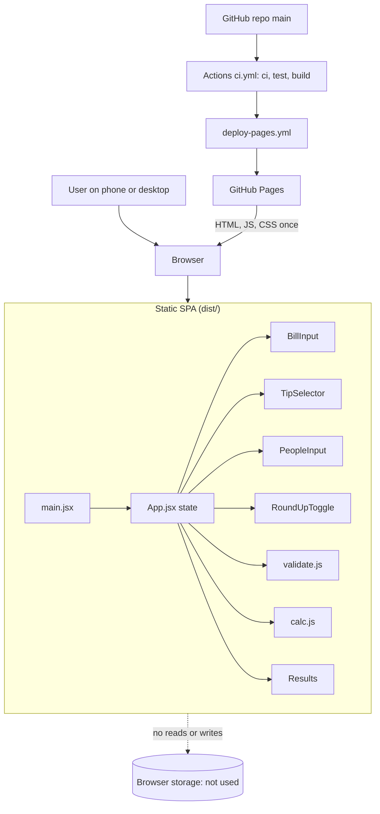

# Solution Design Document (Lite): Tip Calculator

## Overview

The Tip Calculator is a static, front-end-only web app that lets a group of diners (P1 Bill organiser, P2 Group member) split a restaurant bill and tip equally. The user enters a bill amount, picks a tip and enters the number of people. The app then shows the tip, the total and each person's share live, with an optional round-up of each share to the next $0.50. It is built on the demo repo starter template, is deployed to https://shindesubodh.github.io/Demo-E2E-SDLC/ and stores no data. The chosen stack is **plain React 18 with hooks and a pure calculation module**. `useState` holds the raw inputs. A pure integer-cents module (`calc.js`) and a pure validation module (`validate.js`) derive the results on every render. Styling is plain CSS with custom properties. Vite 5 builds the app, Vitest 2 + Testing Library test it, and GitHub Actions runs CI and the Pages deployment (Q1, Q8, Q10).

## Questionnaire summary

| Q | Answer in brief | Design consequence |
|---|---|---|
| Q1 Application Nature | Small production demo, single-tenant, one public static site | One single-page app with no routing, tenancy or theming layer |
| Q2 Users & Scale | Diners on phones, also desktop; ~100 concurrent, ~5,000 per year; current Chrome, Safari, Firefox and Edge | Mobile-first CSS from 320 px; static hosting covers the load; no polyfills beyond Vite defaults |
| Q3 Availability | No SLA; RTO is one redeploy (~10 min); RPO not applicable | Rely on GitHub Pages; recovery means re-running `deploy-pages.yml` |
| Q4 Performance | Updates within 100 ms; first load under 2 s on 4G; bundle under 200 KB gzipped | Results derived synchronously on render, with no debounce; no extra runtime dependencies |
| Q5 Security & Compliance | No sign-in, PII, storage or post-load network calls; WCAG 2.1 AA | No storage module; ARIA labels, `aria-pressed`, `aria-describedby` and a live region |
| Q6 AI | Not applicable | No AI components or external API calls |
| Q7 Integration | None | No API client, no secrets |
| Q8 Infrastructure | GitHub Pages; template CI (`npm ci`, `npm test`, `npm run build`) and Pages deploy | Keep the template workflows unchanged; Vite `base: '/Demo-E2E-SDLC/'` |
| Q9 Team & Operations | One React developer; Admin owns operations; monitoring is CI and deploy status | Simple file layout; no analytics or error tracking |
| Q10 Budget & Timeline | Zero budget, open source, one sprint of 16 of 18 points | React 18 only at runtime; integer-cents `calc.js`; plain CSS tokens |

## Architecture diagram



## Components

| Component (file) | Responsibility | Stories served |
|---|---|---|
| `src/main.jsx` | Mounts `<App />` into `#root` (template file, unchanged) | All |
| `src/App.jsx` | Holds the input state (`bill`, `tipPreset`, `customTip`, `people`, `roundUp`, `touched`). Calls `validate.js` and `calc.js` on each render and passes the props down. | S1–S5 |
| `src/components/BillInput.jsx` | Labelled "Bill amount ($)" text input with `inputMode="decimal"`. Shows the inline error. | S1, S5 |
| `src/components/TipSelector.jsx` | Preset buttons (10, 15, 20) with `aria-pressed`, plus the custom tip field. Clears the preset selection while a custom value is typed. | S2, S5 |
| `src/components/PeopleInput.jsx` | Labelled people field with `inputMode="numeric"`. Shows the inline error. | S3, S5 |
| `src/components/RoundUpToggle.jsx` | Checkbox styled as a switch (`role="switch"`), off by default | S4 |
| `src/components/Results.jsx` | Shows tip, total and per person, plus the rounded lines when on. Shows '—' when inputs are invalid. Wrapped in an `aria-live="polite"` region. | S3, S4, S5 |
| `src/components/FieldError.jsx` | Inline message with an `id` used by `aria-describedby` | S5 |
| `src/lib/calc.js` | Pure integer-cents maths: tip, total, share, round-up | S3, S4 |
| `src/lib/validate.js` | Pure parsing and range checks; returns cents or tenths of a percent, or an error | S1, S2, S3, S5 |
| `src/lib/format.js` | Formats cents as a USD string, e.g. `$1,234.50` | S3, S4 |
| `src/styles.css` | Design tokens (CSS custom properties), mobile-first layout, focus styles | All (NFR-03, NFR-04) |

## Data flow

Main action: the user types a value, for example the number of people.

1. The user types `3` in PeopleInput. Its `onChange` calls `setPeople('3')` and marks `people` as touched (Q4).
2. React re-renders `App.jsx` synchronously with the new state.
3. `App` calls `validateBill`, `validateTip` and `validatePeople` from `validate.js`. Each returns `{ ok, value, error }`. The bill value is in cents and the tip value is in tenths of a percent.
4. If all three are valid, `App` calls `calculate({ billCents, tipTenths, people, roundUp })` from `calc.js` and gets a `Result` in cents. If any input is invalid, the result is `null`.
5. **Storage step: none.** Nothing is written to localStorage, sessionStorage, cookies or IndexedDB, and no network call is made (Q5).
6. `Results` formats the cents with `formatUSD`, or shows '—' when the result is `null`. Inline errors show only for touched fields.
7. The `aria-live` region announces the updated per-person line. The whole flow runs in a single render, well under 100 ms (Q4).

## Interfaces and storage contract

**There is no server API** (Q7, Q8). The contracts are the pure module functions below.

| Function (module) | Inputs | Output | Errors |
|---|---|---|---|
| `validateBill(raw)` (`validate.js`) | `string` | `{ ok: true, value: cents:int }` or `{ ok: false, error: string }` | Empty → "Enter the bill amount". Not a number, more than 2 decimals, or outside 0.01–99,999.99 → "Enter an amount from $0.01 to $99,999.99 (up to 2 decimals)" |
| `validateTip(preset, rawCustom)` | `10\|15\|20\|null`, `string` | `{ ok, value: tenthsOfPercent:int }` (e.g. 12.5% → 125) | No preset and empty custom → "Choose or enter a tip". Outside 0–100 or more than 1 decimal → "Enter a tip from 0 to 100% (whole number or one decimal)" (assumption A6) |
| `validatePeople(raw)` | `string` | `{ ok, value: int }` | Not a whole number from 1–50 → "Enter a whole number from 1 to 50" |
| `calculate({ billCents, tipTenths, people, roundUp })` (`calc.js`) | integers and a boolean | `Result` (see Data model) | Throws `RangeError` if an input is outside its validated range (a programming error; never shown to the user) |
| `roundUpToHalfDollar(cents)` | `int` | `int`, the next multiple of 50 | Same `RangeError` rule |
| `formatUSD(cents)` (`format.js`) | `int` or `null` | `"$1,234.50"`, or `"—"` for `null` | None |

**Calculation rules (assumptions A1 and A2):**

| Value | Rule |
|---|---|
| `tipCents` | `round_half_up(billCents × tipTenths / 1000)` |
| `totalCents` | `billCents + tipCents` |
| `perPersonCents` | `round_half_up(totalCents / people)` |
| `roundedPerPersonCents` | `ceil(totalCents / people / 50) × 50`, computed in integer arithmetic from the exact share |
| `collectedCents` | `roundedPerPersonCents × people` |
| `overpaymentCents` | `collectedCents − totalCents` |

Half-up rounding uses integer division only: `Math.floor((2n + d) / (2d))` for numerator n and denominator d. No floats are used.

**Browser-storage contract:** none. The app reads and writes no keys, so there is no JSON shape and no version field. If saving is added later, it must use a key such as `tipcalc.v1` with a `{ "version": 1, ... }` field. That would be a change request (Q5, NFR-05).

## Data model

The data lives only in memory and is never persisted.

**InputState (`App.jsx` useState)**

| Field | Type | Required | Description |
|---|---|---|---|
| `bill` | string | Yes | Raw bill text, `''` on load |
| `tipPreset` | 10 \| 15 \| 20 \| null | Yes | Selected preset, `null` on load or while a custom tip is used |
| `customTip` | string | Yes | Raw custom tip text, `''` on load |
| `people` | string | Yes | Raw people text, `''` on load (assumption A3) |
| `roundUp` | boolean | Yes | Round-up toggle, `false` on load |
| `touched` | `{ bill, tip, people: boolean }` | Yes | Shows an error only after the field is edited or blurred |

**Result (returned by `calculate`)**

| Field | Type | Required | Description |
|---|---|---|---|
| `tipCents` | integer | Yes | Tip amount, rounded half up |
| `totalCents` | integer | Yes | Bill + tip |
| `perPersonCents` | integer | Yes | Equal share, rounded half up |
| `roundedPerPersonCents` | integer | No | Present only when `roundUp` is true |
| `collectedCents` | integer | No | Rounded share × people |
| `overpaymentCents` | integer | No | Collected − total, ≥ 0 |

## Technology stack

| Layer | Choice | Version | Justification | Questionnaire ref |
|---|---|---|---|---|
| UI framework | React | 18.x | Template baseline; hooks are enough for 5 inputs | Q9, Q10 |
| State | `useState` with derived values | React 18 | Synchronous render meets the 100 ms target with no extra library | Q4 |
| Money maths | Custom `calc.js` in integer cents | — | Exact to the cent, with no dependency | Q4, Q10 |
| Styling | Plain CSS with custom properties | CSS3 | Zero bundle cost; tokens are reused from the Phase 4 mockup | Q4, Q10 |
| Build | Vite | 5.x | Template baseline; static `dist/` output | Q8 |
| Tests | Vitest + Testing Library + jsdom | 2.x / current | Template baseline; fast unit and integration tests | Q8, Q9 |
| CI | GitHub Actions `ci.yml` | — | Already in place; free | Q8, Q10 |
| Hosting | GitHub Pages via `deploy-pages.yml` | — | Free static hosting; covers the expected load | Q2, Q3, Q8 |

## Repository structure

Files marked (template) already exist; the others are new.

```
Demo-E2E-SDLC/
├── .github/workflows/ci.yml            (template, unchanged)
├── .github/workflows/deploy-pages.yml  (template, unchanged)
├── index.html                          (template; title and lang="en" set)
├── package.json                        (template; scripts unchanged)
├── package-lock.json                   (template)
├── vite.config.js                      (template; base '/Demo-E2E-SDLC/')
└── src/
    ├── main.jsx                        (template; imports styles.css)
    ├── App.jsx                         (template, replaced with the app)
    ├── App.test.jsx                    (template, replaced with integration tests)
    ├── styles.css
    ├── components/
    │   ├── BillInput.jsx
    │   ├── TipSelector.jsx
    │   ├── PeopleInput.jsx
    │   ├── RoundUpToggle.jsx
    │   ├── Results.jsx
    │   └── FieldError.jsx
    └── lib/
        ├── calc.js
        ├── calc.test.js
        ├── referenceCases.js
        ├── validate.js
        ├── validate.test.js
        ├── format.js
        └── format.test.js
```

## Environment variables and build configuration

- **Environment variables: none.** The app has no server, API keys, secrets or environment-specific endpoints (Q5, Q7). No `.env` files are created.
- **Vite base path:** `vite.config.js` sets `base: '/Demo-E2E-SDLC/'` so assets resolve at https://shindesubodh.github.io/Demo-E2E-SDLC/ (Q8).
- **Vitest:** `test: { environment: 'jsdom' }` stays as in the template.
- **Scripts:** `dev`, `test` and `build` stay unchanged. CI runs `npm ci`, `npm test` and `npm run build`, and `deploy-pages.yml` publishes `dist/` on merge to main (Q8).
- **Bundle budget:** check the `vite build` output size; the target is under 200 KB gzipped (Q4).

## Testing approach

| Test file | Type | What is tested | Stories |
|---|---|---|---|
| `src/lib/calc.test.js` | Unit | All 10 approved reference cases from `referenceCases.js` (D-03), checked with `toBe` on integer cents. Covers the US-03 and US-04 examples ($100/15%/4 → 1500/11500/2875; $85.40/20%/3 → 1708/10248/3416, rounded 3450/10350/102) and the limits: $0.01, $99,999.99, 0%, 100%, 1 and 50 people. Also checks that an exact $28.50 share gives 0 overpayment and that out-of-range calls throw `RangeError`. | S3, S4 |
| `src/lib/validate.test.js` | Unit | Bill: 85.40 valid; 0, 100000, 12.345 and empty invalid. Tip: 12.5 valid; 101, -1 and 12.55 invalid. People: 0, 51 and 2.5 invalid. | S1, S2, S3, S5 |
| `src/lib/format.test.js` | Unit | `$1,234.50`, `$0.01`, `$99,999.99`; `null` → '—' | S3, S4 |
| `src/App.test.jsx` | Integration (Testing Library + user-event) | Label "Bill amount ($)" and `inputMode`; preset `aria-pressed` toggling and the custom tip clearing the preset; live results after typing with no button; round-up off on load, on/off line visibility; '—' when invalid and never NaN or Infinity; errors linked by `aria-describedby` and hidden until touched; keyboard tab order through the presets | S1–S5 |
| Manual | Deployed check | Four browsers and a phone, 320 px layout, contrast, update under 100 ms in dev tools (per the DoD) | All |

Every acceptance criterion maps to at least one automated test (DoD). CI runs them all on every push (Q8).

## ADRs

### ADR-1: Tech stack

- **Context:** The app needs live, cent-exact results on phones, with zero budget, on the template's React 18 + Vite 5 stack, CI and Pages (Q4, Q8, Q10).
- **Options considered:**
  1. Plain React with hooks and a pure integer-cents `calc.js`, styled with plain CSS custom properties.
  2. React with `useReducer` plus a money library (e.g. dinero.js) and CSS Modules.
  3. React with Zustand for state and Tailwind CSS for styling.
- **Decision:** Option 1, chosen by the Admin.
- **Rationale:** No extra runtime dependencies keeps the bundle small (Q4). Pure functions are easy to test against the reference table (Q9). It fits one developer and one sprint (Q9, Q10). The template scripts and Pages deployment stay unchanged (Q8).
- **Consequences:** We own the rounding code, so it needs thorough tests. Design tokens are hand-written CSS variables. Adding features later may call for `useReducer`.
- **Status:** Accepted

### ADR-2: Money representation and rounding

- **Context:** NFR-01 requires results exact to the cent with no float artefacts; round-up must use the exact share (A1, A2; Q4).
- **Options considered:**
  1. Integer cents, with the tip held as tenths of a percent and half-up rounding done by integer division.
  2. JavaScript floats with `toFixed(2)`.
  3. A decimal library (decimal.js or dinero.js).
- **Decision:** Option 1.
- **Rationale:** It is exact for the full input range. The largest intermediate value, 9,999,999 × 1,000, is far below `Number.MAX_SAFE_INTEGER`. It adds no dependency (Q10). Floats risk rounding errors such as 1.005 → 1.00.
- **Consequences:** All values cross the module boundary as integers, and `format.js` converts them for display. The tests must cover half-cent boundaries.
- **Status:** Accepted

### ADR-3: State and storage design

- **Context:** Results must update within 100 ms, and nothing may be stored or sent (Q4, Q5).
- **Options considered:**
  1. Raw strings in `useState`, with results derived during render and no storage.
  2. Results stored in state and recomputed in `useEffect`, with inputs persisted to localStorage.
  3. Inputs debounced by 150 ms, then computed.
- **Decision:** Option 1.
- **Rationale:** A single synchronous render has no stale state and no extra renders, so updates stay under 100 ms (Q4). No storage meets NFR-05 (Q5). Option 3 would break the 100 ms target.
- **Consequences:** Inputs reset on page reload, which is accepted because saving is out of scope. Raw strings keep the user's exact typing intact for validation.
- **Status:** Accepted

## Sign-off

| Role | Name | Decision | Date |
|---|---|---|---|
| Approver (Sponsor, Product Owner) | Admin | Pending gate approval | — |

Status: **Pending gate approval** (Phase 3 gate: SDD sign-off).
